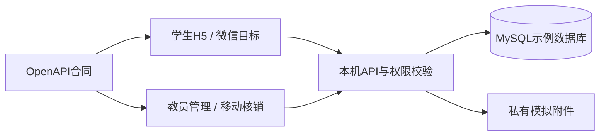

# 粤木木木能量 · 校园实践与积分协同平台

**把报名、实践、独立审核、积分与兑换连成可追溯的流程。** 这是包含学生H5、教员/运营管理网页、移动核销入口和真实MySQL后端的本地演示工程。

[静态演示导览](https://yangwei251003.github.io/yuemumu-rewards-platform/) · [MIT](LICENSE) · [版本来源](docs/VERSION_PROVENANCE.md) · [第三方说明](THIRD_PARTY_NOTICES.md)


## 当前状态与在线体验范围

**开发中的本地演示，所有身份、积分、库存与材料均为虚构示例。制度仍为DRAFT_FOR_DEMO，未代表教员批准、真实学校运营、实物采购或资金支付。**

GitHub Pages发布真实截图、流程说明与启动入口，属于静态演示导览。完整报名、审核、计分、兑换、核销和私有附件访问需要本机API/MySQL；Pages没有连接真实后台，也不接收学生资料、账号或支付信息。

当前代码只允许隔离的`APP_MODE=demo`，明确拒绝生产身份模式。正式身份接入、微信真机、云部署、备份恢复运维和真实业务授权仍需后续验收，不把源码归档称为生产上线。

## 功能与技术

| 范围 | 当前实现 |
|---|---|
| 学生端 | Taro4.2 / React18 / TypeScript，发现、实践、学习、奖励、成长档案等H5页面，保留微信构建目标 |
| 管理端 | React18 / Ant Design5，按角色组织审核、活动、库存、兑换与移动核销等界面 |
| 后端 | NestJS11 / Express5 / MySQL / Drizzle，OpenAPI合同与类型化SDK |
| 积分规则 | 木能量、成长里程与技能翼章分开计算；追加账本、冲正、批次溯源、请求/业务幂等、事务回滚 |
| 权限与材料 | 服务端按角色、对象、组织和领取点校验，独立人员审核及利益回避；私有文件不作为公开静态资源 |
| 兑换流程 | 模拟库存、预占/取消/到期/领取状态转换；无付费购分或提现实现 |



## 最简运行（Windows本机）

本轮环境为Windows、Node.js24.15、pnpm10.33.2、MySQL Community8.0.41、Chrome。安装自己的Node/pnpm与MySQL程序后，在仓库根目录执行；不要指定或恢复任何原有数据库目录。

```powershell
git clone https://github.com/yangwei251003/yuemumu-rewards-platform.git
cd yuemumu-rewards-platform
pnpm install --frozen-lockfile
pnpm run setup integration
pnpm db:start
pnpm db:migrate
pnpm db:seed
pnpm build
pnpm demo
pnpm health
```

默认integration网关为`http://127.0.0.1:28080/`，管理端`/admin/`，移动核销`/admin/pickup/`；若端口已占用，脚本核对实例身份并拒绝接管其他服务。

首次setup生成`.runtime/config.json`中的随机本地凭证。只在本机打开该文件，把`demoAccessCode`填入学生演示口令；管理端示例职员为`DEMO_T003`（审核员）或`DEMO_T004`（运营），密码来自本机的`staffPassword`字段。这些是你刚创建的模拟身份，不提供共享密码。

- MySQL程序不在默认安装位置时，先设置`$env:YUEMUMU_MYSQL_BINARY='你的mysqld程序路径'`再执行setup。
- 可在setup前用`YUEMUMU_DB_PORT`、`YUEMUMU_API_PORT`、`YUEMUMU_GATEWAY_PORT`选择独立端口。Windows MySQL本轮遇到中文数据目录兼容问题，必要时用`YUEMUMU_MYSQL_DATA`指定自己拥有的**新ASCII数据目录**，不要指向既有实例。
- `.runtime`、`.env.local`、数据目录、真实学生材料和运行日志均不得提交或共享。默认数据目录由setup生成，和源码目录分开管理；检查生成配置确认实际位置。
- `pnpm demo:stop`仅按当前工作区记录的PID及命令身份停止API/网关。MySQL进程和数据须单独按自己的本机实例管理，切勿按端口强杀不明服务。

其他操作系统的进程管理/MySQL路径未在本轮验证。旧可靠启动/打包工具保留于`scripts/reliable-demo`，它们针对受控安装身份与专用端口设计，不作为上面普通开发步骤的替代。

## 检查与微信目标

```powershell
pnpm typecheck
pnpm lint
pnpm test
pnpm test:browser
node --test scripts/backup-restore.test.mjs scripts/backup-commerce.test.mjs tests/integration/demo-startup.test.mjs
```

浏览器测试要求使用B或integration隔离配置并已启动服务。微信编译需要显式的API地址：`$env:TARO_APP_API_BASE='你自己的HTTPS API地址'`后执行`pnpm build:weapp`。本轮仅以明确不可访问的示例地址验证编译，不代表微信主体、真机、域名白名单或实际接口已开通。

## 本轮证据与限制

2026-10-26：核对8个本地版本的提交祖先关系，采用包含已有分支增量的最新完整基线；保留3份独立优化说明，未删改任何原件。过滤原运行配置、数据库、私有附件、原送审材料与历史证据，使用新目录/独立端口从14个迁移创建示例数据库。

已执行：159项真实API/MySQL测试、24项离线备份/启动守卫、类型与lint、API/学生H5/管理端构建及微信目标编译。浏览器对新版导航、同浏览器身份隔离、27张奖励图片、尺寸适配、过期会话、明确标注的离线/503故障注入和恢复进行了实际检查；另执行四身份创建活动、签到、成果、独立审核与真实示例账本入账的闭环。每项最终结果与本轮截图以`docs/VERIFICATION.md`及配图为准，不继承历史完成声明。

生产依赖审计为0项。完整开发工具审计仍有11项（含2critical），集中于Taro旧模板下载链及HTML压缩器等。Vite6已进行有界兼容适配与实际构建/浏览器回归，但Taro框架插件仍声明Vite4的peer范围。不要使用该旧CLI获取不可信远程模板或将开发服务器暴露到公网；不能据本轮测试声称整条工具链安全审计通过。逐项路径见[依赖安全范围](docs/SECURITY_STATUS.md)。

后续优先：维护Taro构建链、正式身份与真实业务授权、微信真机/完整部署验证，再扩展业务规则。本仓库与私有数据库备份承担不同职责，**当前不批准删除任何本地原版本或原始私有材料**。

## 目录与保存范围

```text
apps/api/            API、权限和业务入口
apps/student/        Taro学生端H5/微信目标
apps/ops/            管理端与移动核销
packages/contracts/  OpenAPI、生成类型与合同哈希
packages/domain/     账本、幂等与领域状态转换
packages/db/         迁移与数据访问
packages/sdk/        多端传输与类型化调用
data/                明确为草案/虚构的政策、库存与身份示例
assets/              原创示意图、AI场景与已登记标识
tests/               API/集成/浏览器测试源码
docs/site/           静态导览与本轮无私密信息的真实画面
```

源码仓库保留完整必要源码、平台配置、迁移、锁文件、测试及来源许可；依赖缓存、构建目录与私有数据不上传。Pages只保存独立导览成品，不提供数据库或托管完整后端。
